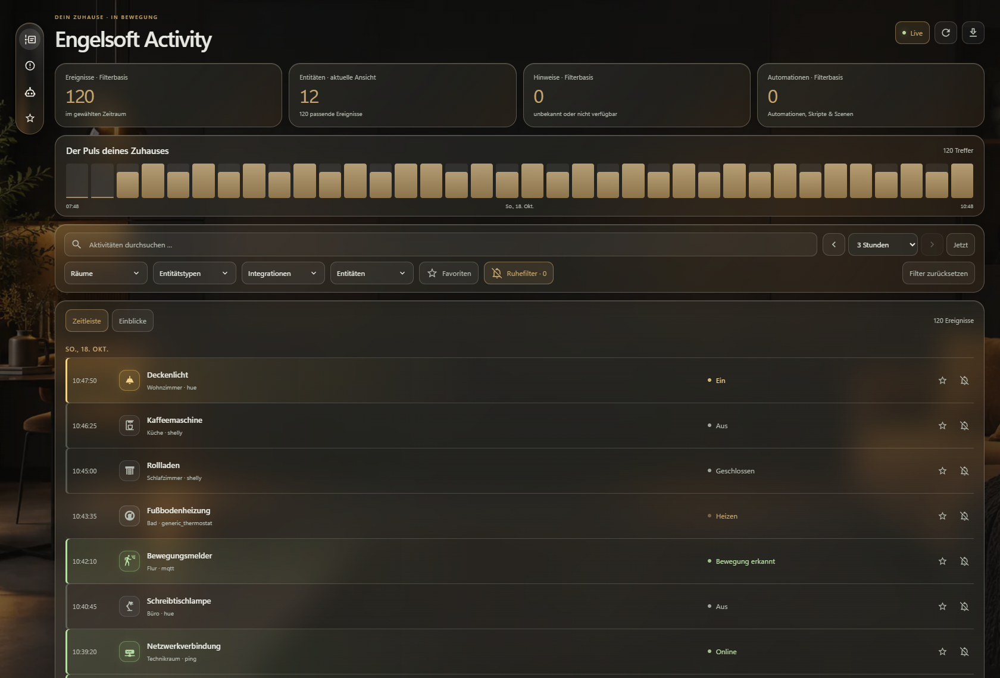
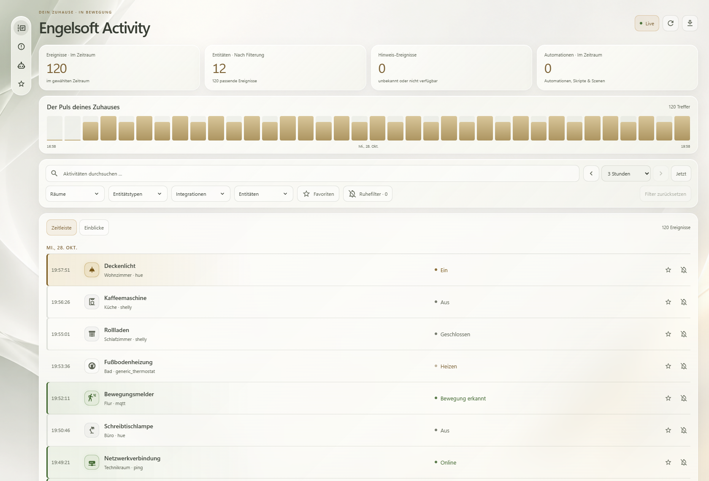

# Engelsoft Activity


**Your home. One timeline. No guesswork.**

[](https://github.com/engelsofta/engelsoft-activity/releases/latest)
[](https://github.com/engelsofta/engelsoft-activity/actions/workflows/checks.yml)
[](LICENSE)
[](https://github.com/engelsofta/engelsoft-activity/releases)

Engelsoft Activity is a local Home Assistant integration that turns your existing logbook into a clear, searchable timeline. It appears in the sidebar as **Activity**.



*Illustrative desktop demo using entirely synthetic devices, rooms and events. No data from a real home is shown. The activity interface currently uses German labels; setup is available in English and German.*

### Light mode



*Privacy-safe light-mode preview generated from the actual panel with entirely fictional data. Pearl glass cards, a locally bundled abstract wallpaper and champagne-gold accents keep the timeline readable. No private screenshot or household data is published.*

## Features

- Live timeline with distinct colors for on/off, online/offline, warnings and alarms.
- Engelsoft glass design, light and dark themes, and a responsive mobile layout.
- Searchable multi-select filters for rooms, entity types, integrations and individual entities.
- Favorites and a local quiet filter for hiding selected entities.
- Clickable activity histogram and a ranking of the most active entities.
- Event details with shared HA context and access to entity details.
- 1, 3, 6, 12 and 24-hour windows, previous/next navigation and CSV export.
- Recent events first, background history loading and a loading indicator without layout shifts.

## Install with HACS

Add this repository as a **custom repository**. It is not automatically included in the HACS default catalog.

1. Open **Custom repositories** in HACS.
2. Add `https://github.com/engelsofta/engelsoft-activity` with type **Integration**.
3. Download **Engelsoft Activity** and restart Home Assistant.
4. Go to **Settings → Devices & services → Add integration** and search for **Engelsoft Activity**.
5. Open **Activity** in the sidebar.

Tested baseline: Home Assistant **2026.10**. The HA logbook must be enabled.

## Manual installation — runtime files only

The [release](https://github.com/engelsofta/engelsoft-activity/releases/latest) provides two small archives:

- **Engelsoft-Activity-0.1.18.zip:** contains only `custom_components/engelsoft_activity/…`. Extract it into your HA configuration directory.
- **engelsoft_activity.zip:** contains the same runtime files at the archive root and is intended for HACS. For manual installation, extract it only into `custom_components/engelsoft_activity/`.

Restart HA, then add the integration as described above. No YAML is required. After updates, restart HA and fully reload the browser page.

**Keep repository files off HA:** installation archives exclude Git metadata, workflows, tests, screenshots, documentation, tools, logs and backups. Do not copy the entire repository into your HA configuration directory.

## Using the filters

Each filter includes search and checkboxes. Multiple selections within a filter use **OR**; different filters combine with **AND**. An empty selection includes all values.

For example, two rooms + one integration + five entities shows events for those entities that belong to the selected integration and either room.

The star marks favorites. The crossed-out bell hides an entity while the quiet filter is enabled. Restore hidden entities under **Einblicke → Ausgeblendete Entitäten** (Insights → Hidden entities). This does not change HA recording, devices or notifications.

The **Im Zeitraum** counters and **Hinweis-Ereignisse** follow search and multi-select filters, excluding the category and histogram time focus. **Nach Filterung**, the timeline and export follow the current selection. Hint events count historical unknown/unavailable events, not currently faulty devices.

On small screens, expand **Filter** to change selections; active filter chips remain visible and can be removed individually. Reset is enabled when a filter is active. The quiet filter is highlighted only when enabled with at least one hidden entity. Histogram counts appear on hover, keyboard focus or selection; each bar also has an accessible count and time-range label.

## Privacy and limitations

- No separate cloud service, telemetry or embedded credentials. Requests use your existing authenticated HA connection.
- Favorites and hidden entities are stored in the browser, separated by HA user. A short-lived cache exists only in session memory.
- CSV downloads are explicitly requested and may contain personal logbook data.
- The bundled background is served locally without external image requests.
- History follows HA retention and logbook exclusions. Room assignments use the current registry, not historical assignments.
- Registry access depends on HA permissions. The timeline remains available if enrichment fails, but some filters may be incomplete.
- Shared context comes from HA and is not independent root-cause analysis.
- The activity interface is currently German-only; setup supports English and German.

## Development

```sh
npm ci
npm test
npx playwright install chromium
npm run test:browser
python scripts/package.py
```

Browser tests use synthetic data and do not replace testing on a real HA instance. The package builder checks an explicit file allowlist, archive contents and version consistency. GitHub Actions also runs Hassfest.

README images are documentation only and excluded from both installation archives.

## Support

[Report an issue](https://github.com/engelsofta/engelsoft-activity/issues) · [Releases](https://github.com/engelsofta/engelsoft-activity/releases)

Do not post full HA logs, credentials or private configuration files in public issues.

Released under the [MIT License](LICENSE).
