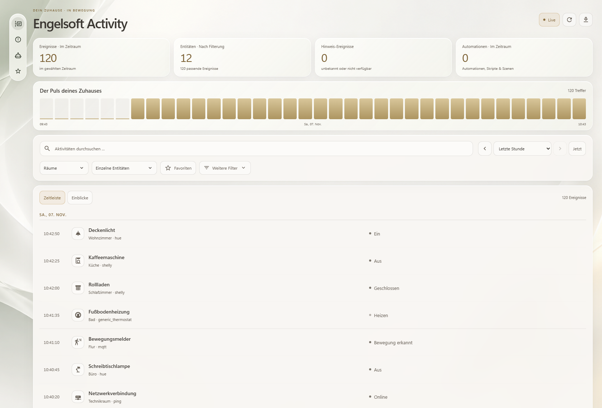

# Engelsoft Activity

**Your home has gossip. We brought a timeline.**

An alternative to Home Assistant's built-in **Activity** view. Engelsoft Activity turns your existing logbook into a searchable live timeline and adds its own **Activity** sidebar panel. The built-in view remains available.

## Dark mode

## Light mode

Both previews use fictional rooms, devices and events. The panel follows your Home Assistant light/dark theme.

## What you get

- **Live timeline:** new logbook events arrive through your existing Home Assistant connection.
- **Flexible history:** opens with the last hour; choose 1, 3, 6, 12 or 24 hours and browse previous periods.
- **Search and filters:** find events by room, individual entity, entity type or integration.
- **Favorites and hidden entities:** keep useful events close and reduce noise without changing Home Assistant recording.
- **Activity chart and insights:** focus on a time segment or see which entities generated the most events.
- **Event details and CSV export:** inspect original messages, timestamps and shared event contexts, or download your filtered timeline.
- **Responsive layout:** neutral event rows, fault indicators and controls adapted for desktop and mobile.

## Install

Requires **Home Assistant 2026.11+** with the logbook enabled.

[Open in Marketplace](https://my.home-assistant.io/redirect/marketplace_repository/?owner=engelsofta&repository=engelsoft-activity&category=integration)

1. Open the link above and add the custom repository if prompted, then select **Install**.
2. Add **Engelsoft Activity** under **Settings → Devices & services**.
3. Open **Activity** in the sidebar. Follow any restart prompt.

After updating, restart Home Assistant and reload your browser.

## Quick guide

- Use **Räume** for rooms and **Einzelne Entitäten** for individual entities. **Weitere Filter** contains entity types and integrations. Multiple choices within a filter use OR; different filters combine with AND.
- Select **Favoriten** to show starred entities. Hover over an event or focus it with the keyboard to access the star and hide controls; these stay visible on touch devices.
- **Ausgeblendet** opens the hidden-entity list under **Einblicke**, where you can restore entities. Hiding only affects this panel.
- Remove an active filter with its ×, or select **Alle Filter löschen**. Select **Jetzt** to return from a historical period to live activity.
- Select an event for details. Known Shelly button messages are shortened in the timeline; details and CSV exports retain the original message.

## Privacy and limits

No telemetry or external runtime services. Favorites and hidden-entity preferences stay in your browser, separated by Home Assistant user. CSV exports can contain private activity data.

History follows Home Assistant logbook retention, exclusions and permissions. Room information uses the current registry. The panel interface currently uses **German labels**; setup supports English and German.

This is a community integration, not an official Home Assistant product.

[Changelog](CHANGELOG.md) · [Releases](https://github.com/engelsofta/engelsoft-activity/releases) · [Report a bug](https://github.com/engelsofta/engelsoft-activity/issues) · [MIT License](LICENSE)
