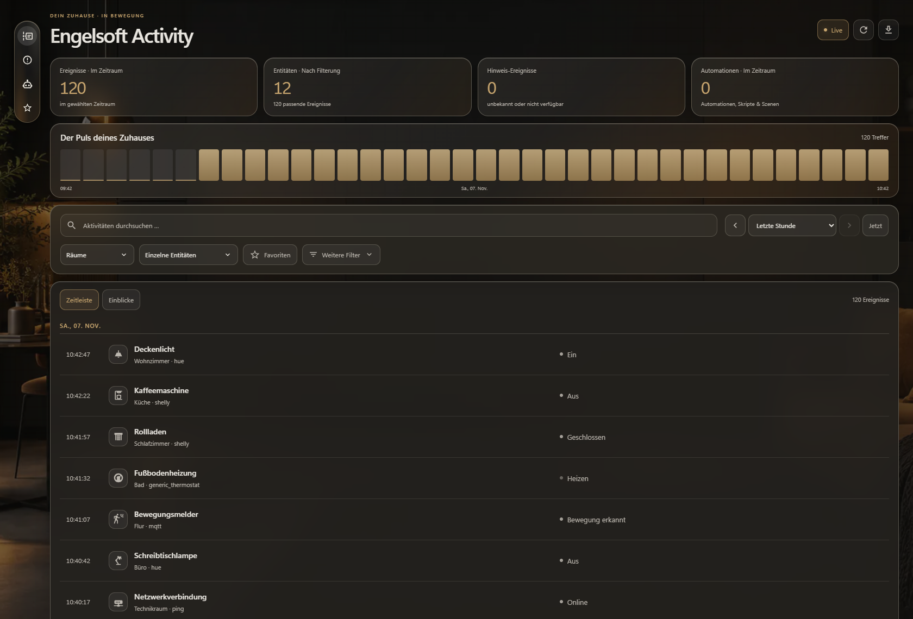

# Engelsoft Activity

**Your home has gossip. We brought a timeline.**

An alternative to Home Assistant's built-in **Activity** view: a searchable live timeline with room and entity filters, favorites, hidden entities and event details. Uses your existing logbook and adds its own **Activity** sidebar panel.

## Install

Requires **Home Assistant 2026.11+** with the logbook enabled.

[Open in Marketplace](https://my.home-assistant.io/redirect/marketplace_repository/?owner=engelsofta&repository=engelsoft-activity&category=integration)

1. Open the link above and add the custom repository if prompted, then select **Install**.
2. Add **Engelsoft Activity** under **Settings → Devices & services**.
3. Open **Activity** in the sidebar. Follow any restart prompt; after updates, restart Home Assistant and reload the browser.

## Good to know

- Opens with the **last hour**; supports live updates, historical periods and CSV export.
- No telemetry or external runtime services. Favorites and hidden-entity preferences stay in your browser, per user. Exported CSV files can contain private activity data.
- Uses Home Assistant's logbook retention and permissions. The panel interface currently uses German labels; setup supports English and German.
- The preview uses fictional data. This is a community integration; the built-in Activity view remains available.

[Changelog](CHANGELOG.md) · [Report a bug](https://github.com/engelsofta/engelsoft-activity/issues) · [MIT License](LICENSE)
